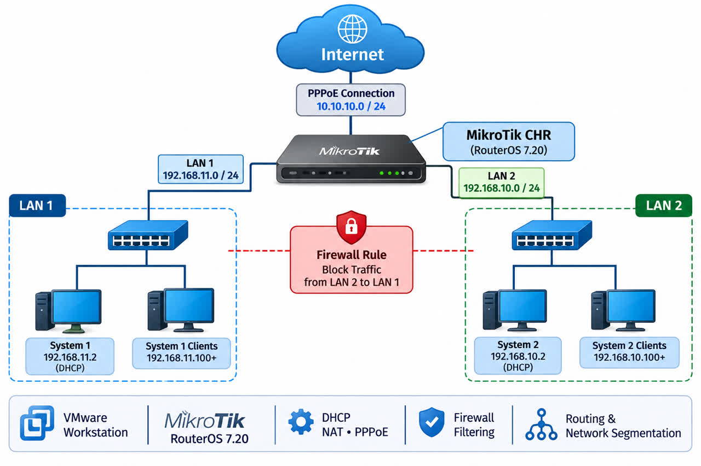

# mikrotik-vmware-network-lab
Mikrotik RouterOS 7.20 Network lab using VMware Workstation
# MikroTik Network Lab – VMware Workstation

## Project Overview

This project demonstrates the design and implementation of a virtual network infrastructure using MikroTik RouterOS 7.20 and VMware Workstation.

The lab consists of a virtual MikroTik router and two Windows client machines connected through separate virtual networks.

The main objective is to practice network configuration, IP addressing, DHCP services, NAT, PPPoE connectivity, routing, and firewall rules in an isolated virtual environment.

## Lab Environment

- Virtualization Platform: VMware Workstation
- Router: MikroTik CHR
- Operating System: MikroTik RouterOS 7.20
- Client Operating Systems: Windows
- Network Configuration: Multiple isolated virtual networks

## Network Topology

| Component | Network / Configuration |
|---|---|
| WAN | VMware NAT – VMnet8 |
| LAN 1 | 192.168.11.0/24 |
| LAN 2 | 192.168.10.0/24 |
| PPPoE Network | 10.10.10.0/24 |
| Management | Dedicated management network |

## Implemented Network Services

- WAN connectivity through VMware NAT.
- DHCP server configuration for LAN clients.
- Network Address Translation (NAT) for internet access.
- Separate IP subnets for network segmentation.
- PPPoE server/client connectivity.
- Routing between network segments.
- Firewall configuration using traffic filtering rules.
- Blocking direct traffic from LAN 2 (192.168.10.0/24) to LAN 1 (192.168.11.0/24).
- Dedicated management connectivity.

## Project Objectives

1. Provide internet access to the designated LAN.
2. Separate two client networks into different IP subnets.
3. Establish PPPoE connectivity between client systems.
4. Control communication between network segments using firewall policies.
5. Practice MikroTik network administration in a virtualized environment.

## Tools & Technologies

- MikroTik RouterOS 7.20
- VMware Workstation
- WinBox
- Windows 10
- TCP/IP
- DHCP
- NAT
- PPPoE
- Firewall
- Routing

## Documentation

This repository includes network topology diagrams, configuration screenshots, and implementation notes.

## Project Type

Personal Networking Lab / Hands-on Network Administration Practice
## Network Topology

The following diagram illustrates the network architecture of this project.

